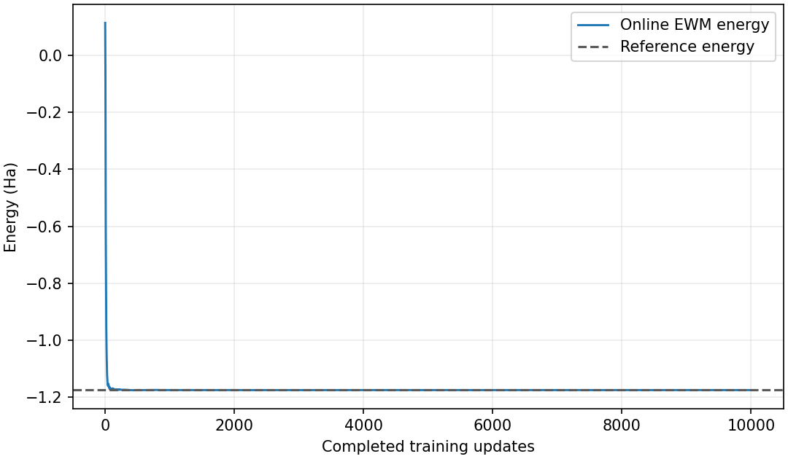
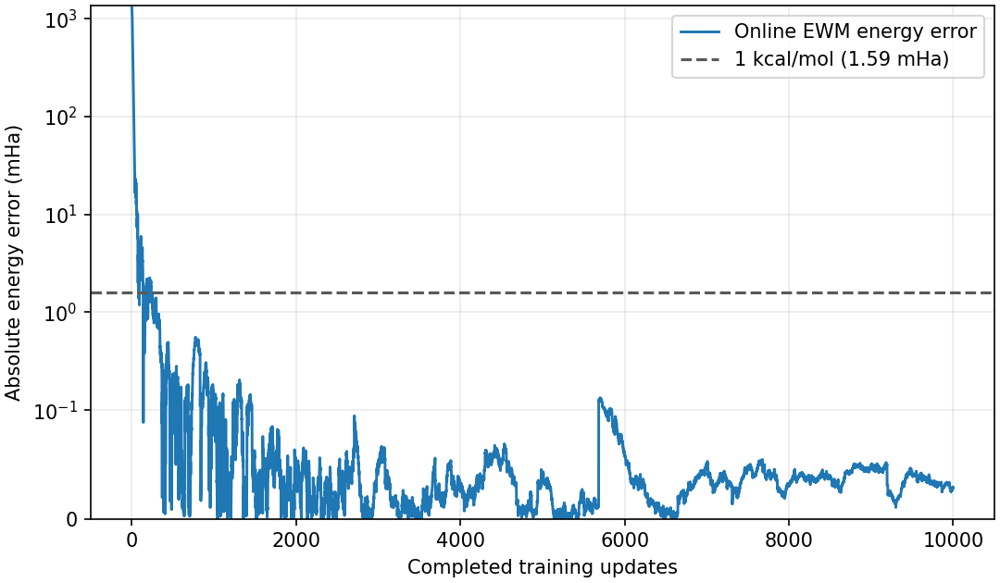
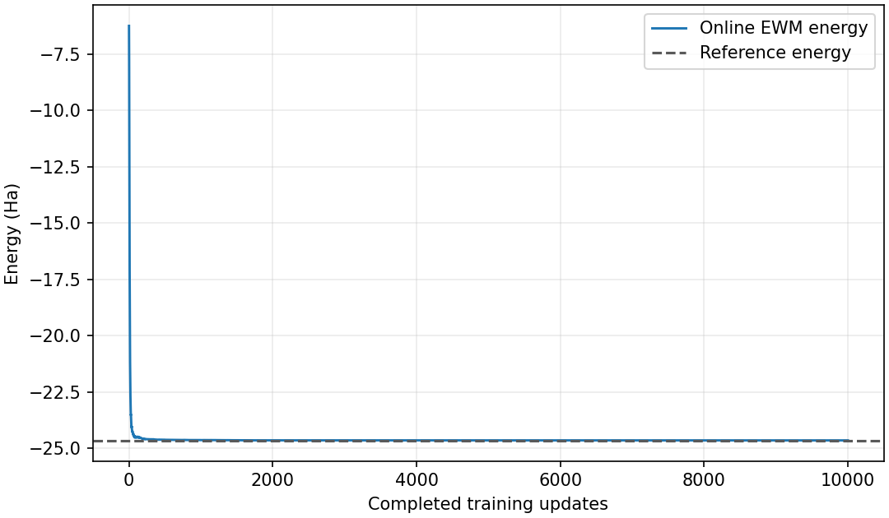
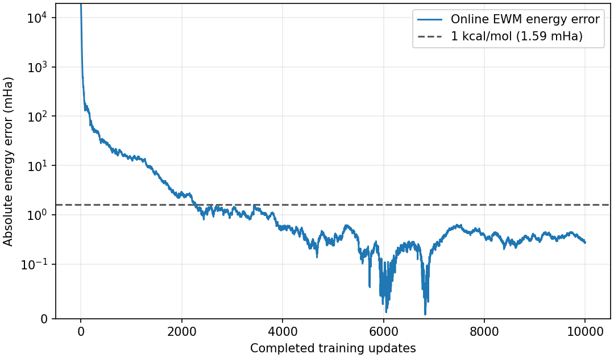
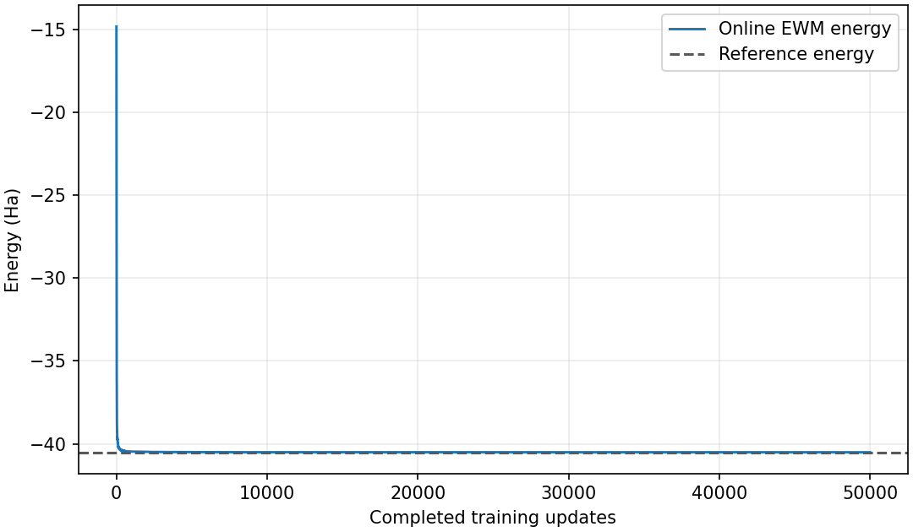
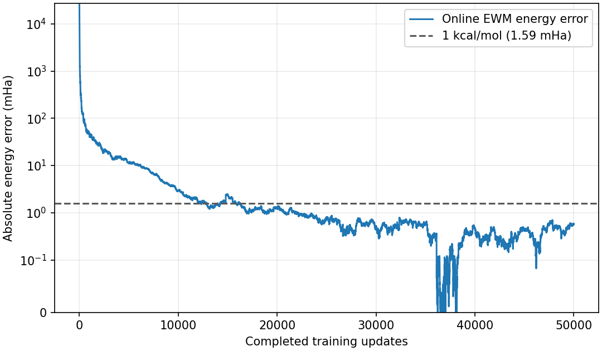
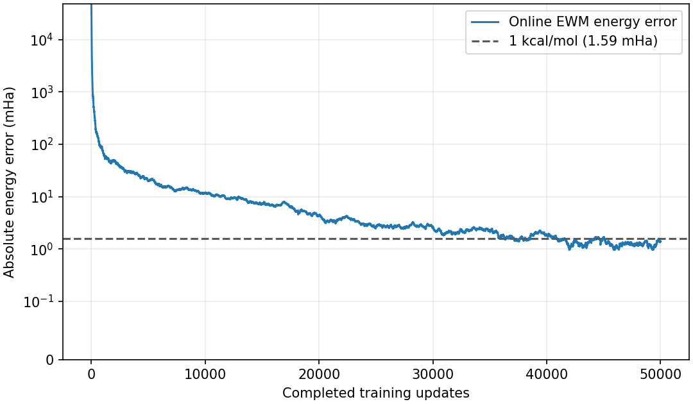

**Warning: Orbformer checkpoints are stored using `pickle`. Never read a checkpoint from an untrusted source.**

# OneQMC

[](https://doi.org/10.5281/zenodo.21160149)

This package provides an implementation of the [Orbformer wave function foundation model](https://arxiv.org/abs/2506.19960).

This README introduces Orbformer-SE scratch-training examples, including four
single-geometry, single-GPU benchmarks. All start from random parameters with zero HF pretraining.
Start with [单卡与四卡训练示例总说明（中文）](docs/TRAINING_EXAMPLES_zh.md)
for the systems, full settings, launch commands, output layout, and metrics.
The four-GPU Ethane BBMEP example uses **seed 219**. The single-GPU examples
use **seed 42**.
Archived results, including energy and absolute error curves for H2, B, CH4,
and single-geometry C2H6, are available in [training_records/](training_records/README.md).
Checkpoint weights, HDF5 files, and TensorBoard event files are not uploaded.

| Example | GPUs (A100 80GB) | Global geometry batch × electron configurations per geometry | Updates / seed | Main metric |
| --- | --- | --- | --- | --- |
| [H2 equilibrium benchmark](examples/h2_equilibrium/README.md), 1 geometry | 1 | **1 × 1024** | 10,000 / 42 | Absolute energy error (mHa) |
| [B atom benchmark](examples/b_atom/README.md), 1 geometry | 1 | **1 × 1024** | 10,000 / 42 | Absolute energy error (mHa) |
| [CH4 equilibrium benchmark](examples/single_geometry_hydrocarbons/README.md), 1 geometry | 1 | **1 × 1024** | 50,000 / 42 | Absolute energy error (mHa) |
| [C2H6 BBMEP image 0 benchmark](examples/single_geometry_hydrocarbons/README.md), 1 geometry | 1 | **1 × 1024** | 50,000 / 42 | Absolute energy error (mHa) |
| LiCN, 5 geometries | 1 | **1 × 2048** | 20,000 / 42 | Online EWM MARE (kcal/mol) |
| H4 rectangles, 6 geometries | 1 | **6 × 256** | 16,000 / 42 | Absolute mean energy (Ha), 200-step trailing average |
| Ethane BBMEP, 20 geometries | 4, single process | **4 × 256**, one geometry per GPU | 32,000 / 219 | Online EWM MARE (kcal/mol) |

H4 energy is plotted directly without subtracting a minimum. LiCN and the
20-geometry Ethane example use MARE based on reference-centered relative
energies. The online curves track training progress. Independent energy
estimates use a separate evaluation run with a fixed checkpoint.

The H2 benchmark has two electrons at a fixed bond length of **1.4011 bohr**
and a reference energy of **−1.1744759314 Ha**. The neutral B atom has five
electrons in a spin doublet and a reference energy of **−24.65386890 Ha**.
Both guides include training, live absolute-error plots, and independent
evaluation commands.
The CH4 and C2H6 launchers automatically evaluate the final checkpoint for
1,000 sampling steps with fresh chains.

The repository includes code, documentation, geometry inputs, small reference-energy
tables in `data/references/`, and the published records above.
**Checkpoint weights (including LAC), HDF5 metrics, TensorBoard event files,
local `runs/` links, platform credentials, and upstream published
`experiment_results/` are excluded.**
Paper figure notebooks require separately obtained upstream result files.
See [交付版本说明](docs/GITHUB_HANDOFF_zh.md).

## H₂ and boron training results

Each run completed **10,000 updates** from random initialization on one A100 80 GB with 1,024 electronic configurations per update and seed 42.

| System | Total training wall time | Update loop wall time | Final training energy (Ha) | Final absolute error (mHa) |
| --- | ---: | ---: | ---: | ---: |
| H₂ at 1.4011 bohr | **1 h 03 min 06 s** | 1 h 01 min 36 s | −1.1744472 | 0.029 |
| Neutral boron (B) | **1 h 08 min 01 s** | 1 h 06 min 23 s | −24.653595 | 0.275 |

Total wall time is measured from the training entry in the OneQMC log through completion. It includes model initialization, sampler equilibration, and JIT compilation. The update-loop time starts at the log entry `Start training` and includes compilation of the first update. Queue time and independent evaluation are outside both intervals.

The VMC objective is energy minimization. The loss trend below uses the exponential moving average (EWM) of the sampled mean local energy. The absolute-error curves compare that same EWM energy with the reference for each system.

| System | VMC energy (loss trend) | Absolute energy error |
| --- | --- | --- |
| H₂ |  |  |
| B |  |  |

Download the full per-step data for [H₂](training_records/h2_equilibrium_scratch_1gpu_10k_s42/results/analysis/absolute_energy_error_online.csv) and [B](training_records/b_atom_scratch_1gpu_10k_s42/results/analysis/absolute_energy_error_online.csv).

## CH₄ single-geometry training results

CH₄ completed **50,000 updates in 7 h 27 min 26 s** on one A100 80 GB.
The automatic evaluation used the final checkpoint for 1,000 sampling steps
and took **7 min 26 s**. Training and evaluation times include initialization,
sampler equilibration, and compilation.

| Metric | Final training EWM | Fixed-checkpoint evaluation |
| --- | ---: | ---: |
| Energy (Ha) | −40.513958 | **−40.514028** |
| Absolute error vs. reference (mHa) | 0.584 | **0.512** |

| VMC energy (loss trend) | Absolute energy error |
| --- | --- |
|  |  |

Download the [50,000-step training CSV](training_records/ch4_single_scratch_1gpu_50k_s42/results/fit/analysis/absolute_energy_error_online.csv) and [evaluation summary](training_records/ch4_single_scratch_1gpu_50k_s42/results/evaluation/analysis/evaluation.json).

## C₂H₆ single-geometry training results

C₂H₆ completed **50,000 updates in 13 h 46 min 14 s** on one A100 80 GB.
The automatic evaluation of the final checkpoint took **15 min 15 s** for
1,000 sampling steps. Both durations include initialization, sampler
equilibration, and compilation.

| Metric | Final training EWM | Fixed-checkpoint evaluation |
| --- | ---: | ---: |
| Energy (Ha) | −79.823440 | **−79.823266** |
| Absolute error vs. reference (mHa) | 1.411 | **1.583** |

The reference energy for this geometry has a reported statistical uncertainty
of 1.636 mHa. [Reference data and protocol](examples/single_geometry_hydrocarbons/README.md)

| VMC energy (loss trend) | Absolute energy error |
| --- | --- |
|  |  |

Download the [50,000-step training CSV](training_records/c2h6_single_scratch_1gpu_50k_s42/results/fit/analysis/absolute_energy_error_online.csv) and [evaluation summary](training_records/c2h6_single_scratch_1gpu_50k_s42/results/evaluation/analysis/evaluation.json).

We also provide the following:
- the [Neural Electron Real-space Density](https://arxiv.org/abs/2409.01306) model, which can be trained from Orbformer checkpoints
 - Light Atom Curriculum dataset, and other datasets referenced in the Orbformer paper
 - notebooks to reproduce figures from the paper

## Installation

You will need compute infrastructure in which it is possible to [install JAX](https://github.com/jax-ml/jax?tab=readme-ov-file#installation).
In our experiments, we used an Nvidia A100 GPU running on Linux with CUDA version 12. Some features of this repository require an Nvidia GPU that has compute
capability 8.0 or later.

1. Clone this repository
```bash
git clone https://github.com/ynny123/oneqmc.git
cd ./oneqmc
```

2. Install and activate the provided `conda` environment, which automatically installs JAX
```bash
conda env create -f environment-os.yaml -n oneqmc
conda activate oneqmc
```
This should take several minutes.

3. Append the location of the `oneqmc` source files to your `PYTHONPATH`
```bash
export PYTHONPATH=$PYTHONPATH:$PWD/src
```

4. Test your set-up with the two-update single-GPU H4 scratch example
```bash
export XLA_PYTHON_CLIENT_PREALLOCATE=false JAX_ENABLE_X64=false
CUDA_VISIBLE_DEVICES=0 python examples/h4_rectangle/run.py --mode smoke --output runs/h4_smoke
```
Use a fresh output directory. The first run includes compilation and can take
several minutes. Installation details and the locked Python 3.11 environment are
documented in the [Chinese runbook](docs/ETHANE_SCRATCH_RUNBOOK_zh.md#3-环境准备).

## Running Orbformer

The main entrypoint for running wave function training and fine-tuning is `transferable.py`.

The [training-example guide](docs/TRAINING_EXAMPLES_zh.md) covers LiCN and H4
single-GPU training and Ethane four-GPU training. The
[H4 guide](examples/h4_rectangle/README.md) documents the six-rectangle geometry convention.

For a complete Chinese walkthrough of the Ethane BBMEP scratch-training setting
(4 devices, 20 geometries, 256 electron configurations per geometry, 32k updates),
see [乙烷多几何从头训练运行说明](docs/ETHANE_SCRATCH_RUNBOOK_zh.md).

### Fine-tuning existing datasets

Many datasets that are mentioned in the paper are provided in the `data` directory.
The TinyMol dataset can be downloaded from the `deeperwin` repository and 
processed into our format by running
```bash
python scripts/download_tinymol_dataset.py
```

Fine-tuning requires a separately obtained trusted checkpoint; weights are not
bundled in this fork. To fine-tune from a LAC checkpoint, use
```bash
python scripts/transferable.py -d <subdirectory of ./data> -c /path/to/lac.chkpt --discard-sampler-state -n <number of training steps> -w <output directory>
```
and to train a model from scratch, use
```bash
python scripts/transferable.py -d <subdirectory of ./data> -n <number of training steps> -w <output directory>
```
We recommend using distinct output directories for every training run.
Regarding other optional arguments, run `python scripts/transferable.py -h` for more information.

**Note**: Checkpoints are stored using `pickle`. This means that opening a checkpoint from an untrusted source is a major security risk. Only ever open checkpoint files from trusted sources. To prevent reading untrusted pickle files, checkpoint reading is disabled by default and can be
re-enabled by setting the environment variable `ORBFORMER_PICKLE_LOADING=1`.

### Preparing new structure data for fine-tuning

To create a new dataset for fine-tuning, we recommend using [qcelemental](https://github.com/MolSSI/QCElemental) format.
Given a Python dictionary of the form
```python
structures: dict[str, qcel.model.Molecule] = {name: mol}
```
you can save this in a format that is readable by `oneqmc` via
```python
structures_flat = {k: v.dict(encoding="json") for k, v in structures.items()}
with open("./data/<dataset name>/structures.json", "w") as f_out:
  json.dump(structures_flat, f_out)
```
We also support nested directories as datasets, and dataset names containing `/`.

An alternative `.yaml` file format is also supported for datasets.

### Evaluation of the energy and accessing logged metrics

We recommend energy evaluation using a fresh evaluation run and by computing a robust mean on the evaluation energies.
A fresh evaluation run from a checkpoint can be launched using the `--test` argument, e.g.
```bash
python scripts/transferable.py -d <subdirectory of ./data> -n <number of test steps> -c <chkpt> --discard-sampler-state -w <different output directory> --test
```
This will run MCMC and energy evaluation without updating the model parameters.
We recommend using separate `-w` output directories for training and evaluation.

The saved energies from the evaluation can be accessed via the `h5` file
```python
from oneqmc.analysis import read_result
from oneqmc.analysis.energy import robust_mean

# If evaluating on a single GPU, this will have shape [num_mols, num_steps]
energy = read_result(
    test_output_directory,
    keys=["E_loc/mean_elec"],
    subdir="training",
)
# Robust mean of energies for structure 0
rmean_0 = robust_mean(energy[0, :]).squeeze()
```

Numerous other metrics are logged during training and evaluation, and be accessed in an analogous way.

A tensorboard log file is also generated automatically during training.

To store less output, you can pass the arguments `--metric-logger-period <int>` and `--metric-logger <subset of {h5, tb} possibly empty>`.

### Pausing and resuming training

Checkpoints are automatically generated during any training or fine-tuning run.
If you run the same training command with the same output directory passed to `-w`, the script will automatically resume from the last checkpoint. This behaviour can be switched off using `--no-autoresume`. To resume from some other checkpoint, pass the `-c` argument *without* using `--discard-sampler-state`, and this will restore the sampler and optimizer states as well as the model parameters.

To store fewer checkpoints, you can pass the arguments `--chkpts-fast-interval` and `--chkpts-slow-interval`.

### Limitations of the upstream LAC checkpoint

It is not possible to fine-tune from the LAC checkpoint on a molecule that contains a nucleus that
is heavier than Fluorine. For such molecule, we suggest training from scratch, or pretraining 
your own model.

### Pretraining your own model

For LAC pretraining Phase 2, we used the following settings, running on 16 GPUs
```bash
python scripts/transferable.py -d lightatomcurriculum/level2 --data-augmentation rotation fuzz --electron-batch-size 1024 --mol-batch-size 16 -n 400000 --max-restarts 200 --multi-system-sampler double-langevin --repeated-sampling-len 40 --max-eq-steps 300 --metric-logger-period 25 -c <phase 1b checkpoint> --discard-sampler-state  -w <output directory>
```

Given an alternative pretraining dataset, you can launch a pretraining by adapting this command. Omit `-c <phase 1b checkpoint> --discard-sampler-state` to begin pretraining
from a randomly initialized network.

### Dealing with out-of-memory errors

There are several strategies that can be employed for very large molecules that would naively cause OOM errors. 

1. Reduce `--electron-batch-size` and set `--mol-batch-size` equal to the number of GPUs.
1. Passing `--local-energy-chunk-size` will cause the local energy to be evaluated sequentially in blocks of the given size. For example, running with `--electron-batch-size 512 --local-energy-chunk-size 128` will compute local energies in 4 passes.
2. To fine-tune on a single, large molecule using multiple GPUs, use the flag `--repeat-single-mol` and pass a dataset of length 1.


## Plots and results from the Orbformer paper

The `notebooks/paper` directory contains notebooks that reproduce the plots shown in the paper.


## Training an electron density model
You can extract the electron density from an Orbformer checkpoint by fitting a new model
```bash
python scripts/density.py -d <dataset of size 1> -c <trained orbformer checkpoint> -w <output directory>
```
Note that density models are currently only supported for single molecules, so the dataset should be of size 1. You can filter out individual molecules from a larger dataset using `--data-file-whitelist` and `--data-json-whitelist`.
You can run `python scripts/density.py -h` for information on other arguments that are accepted by this script.

The training code will automatically evaluate the density on Lebedev-Laikov grids of various sizes during training.


## Citation 

If you use this repository, please cite our work.
The Orbformer model, checkpoints, training scheme:
```bibtex
@article{foster2025ab,
  title={An ab initio foundation model of wavefunctions that accurately describes chemical bond breaking},
  author={Adam Foster and Zeno Sch{\"a}tzle and P. Bern{\'a}t Szab{\'o} and Lixue Cheng and Jonas K{\"o}hler and Gino Cassella and Nicholas Gao and Jiawei Li and Frank No{\'e} and Jan Hermann},
  journal={arXiv preprint arXiv:2506.19960},
  year={2025}
}
```
Electron density extraction:
```bibtex
@article{cheng2025highly,
  title={Highly accurate real-space electron densities with neural networks},
  author={Cheng, Lixue and Szab{\'o}, P Bern{\'a}t and Sch{\"a}tzle, Zeno and Kooi, Derk P and K{\"o}hler, Jonas and Giesbertz, Klaas JH and No{\'e}, Frank and Hermann, Jan and Gori-Giorgi, Paola and Foster, Adam},
  journal={The Journal of Chemical Physics},
  volume={162},
  number={3},
  year={2025},
  publisher={AIP Publishing}
}
```

## Contributing

This project welcomes contributions and suggestions.  Most contributions require you to agree to a
Contributor License Agreement (CLA) declaring that you have the right to, and actually do, grant us
the rights to use your contribution. For details, visit https://cla.opensource.microsoft.com.

When you submit a pull request, a CLA bot will automatically determine whether you need to provide
a CLA and decorate the PR appropriately (e.g., status check, comment). Simply follow the instructions
provided by the bot. You will only need to do this once across all repos using our CLA.

This project has adopted the [Microsoft Open Source Code of Conduct](https://opensource.microsoft.com/codeofconduct/).
For more information see the [Code of Conduct FAQ](https://opensource.microsoft.com/codeofconduct/faq/) or
contact [opencode@microsoft.com](mailto:opencode@microsoft.com) with any additional questions or comments.

## Trademarks

This project may contain trademarks or logos for projects, products, or services. Authorized use of Microsoft 
trademarks or logos is subject to and must follow 
[Microsoft's Trademark & Brand Guidelines](https://www.microsoft.com/en-us/legal/intellectualproperty/trademarks/usage/general).
Use of Microsoft trademarks or logos in modified versions of this project must not cause confusion or imply Microsoft sponsorship.
Any use of third-party trademarks or logos are subject to those third-party's policies.
